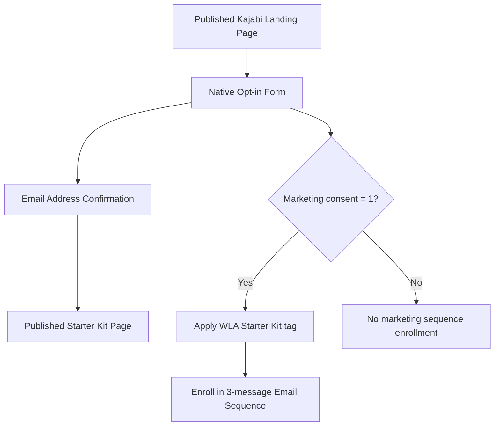

# Kajabi Lead Capture & Email Nurturing — Workflow Lab Academy

**[View the customer-facing case study](https://mahdi-eqbal.github.io/revenue-systems-gtm-engineering-portfolio/projects/kajabi-email-automation/)** · **[Explore the guided workflow](https://mahdi-eqbal.github.io/revenue-systems-gtm-engineering-portfolio/projects/kajabi-email-automation/demo.html)** · **[Main portfolio](https://mahdi-eqbal.github.io/revenue-systems-gtm-engineering-portfolio/)**

**[Watch the narrated visual overview](https://youtu.be/pZIc1UYPD8c)** (illustrated workflow explanation, not a recording of the Kajabi UI)

**Platform:** Kajabi · Landing Pages · Native Forms · Double Opt-in · Contacts · Tags · Automations · Email Sequences  
**Evidence basis:** Controlled Kajabi tests reviewed 20–21 Nov 2026, including direct confirmation of the Day 0 message in the test Gmail inbox  
**Project type:** Independent hands-on implementation for a fictional online-learning business, not a paid-client or production deployment.

## Business objective

Workflow Lab Academy offers a free *AI Productivity Starter Kit* to prospective subscribers. A new visitor should be able to request the resource, verify their email address, and—**only if they separately consent to marketing**—enter a structured three-email educational series.

## What was built in Kajabi

1. **Published lead-capture landing page.** Native Kajabi form with first name, email and an optional unchecked consent box.
2. **Published resource-access page.** The email-confirmation link routes to a browser-accessible Starter Kit with prompts and a checklist.
3. **Contacts and tags.** Confirmed and subscribed test contacts were inspected; the project tag was `WLA - AI Starter Kit Lead`.
4. **Published automation.** Submission triggers an evaluation of the consent form field (contains `1`); an opted-in contact receives the project tag and sequence membership.
5. **Three-step email series.** A welcome email on Day 0, a meeting follow-up exercise on Day 2, and a weekly habit exercise on Day 4 were saved and scheduled. The fresh Day 0 welcome was confirmed received in Gmail on 21 Nov 2026.

## Flow

The diagram describes the implemented resource-access and marketing-consent paths at a conceptual level. Exact trigger execution timing is governed by Kajabi's settings.

## Verification observations

| Scenario | Observation in Work review |
| --- | --- |
| Form submission with consent and email verification | Confirmation email received; contact recorded as Confirmed and Subscribed |
| Positive consent / workflow | Project tag applied and active email-sequence membership observed |
| No consent / workflow | Tested submission did not increase sequence enrollment |
| Confirmed email / resource access | Confirmation link opened the published Starter Kit in browser |
| Published public pages | Both published pages returned HTTP 200 without administrator session |
| Sequence configuration | Three stored messages and Day 0 / Day 2 / Day 4 scheduling inspected |
| **Day 0 inbox delivery** | **A fresh `Your AI Productivity Starter Kit` email was actually received and read in the test Gmail inbox on 21 Nov 2026** |
| Day 2 and Day 4 inbox delivery | Scheduled after the review date; recipient-side delivery not yet assessed |

The Day 0 Gmail observation establishes **actual recipient-side delivery of one test welcome message**, in addition to configuration and enrollment evidence. It does not yet establish delivery of Day 2 or Day 4 messages, general deliverability rates, campaign performance, or commercial conversions. [Review the sanitized QA evidence](QA-VERIFICATION.md).

The no-consent case used a previously confirmed test contact. A separate physical-device post-publication submission is not included in these observations.

## Delivery investigation

Kajabi Support identified an incomplete **Marketing Contact Address** in the account settings as a potential cause of the initial failure to observe marketing-email delivery. After the account investigation and a fresh signup/confirmation test on 21 November, the Day 0 email arrived in the test Gmail inbox. The original earlier sends were not retrospectively validated. Day 2 and Day 4 will be checked after their scheduled dates.

See the [public-safe QA record](QA-VERIFICATION.md) for the verified result, evidence boundaries, and remaining scheduled checks.

## Customer-facing review

- [Narrated project overview on YouTube](https://youtu.be/pZIc1UYPD8c) — illustrated walkthrough, not a platform screen capture
- [Visual project summary](https://mahdi-eqbal.github.io/revenue-systems-gtm-engineering-portfolio/projects/kajabi-email-automation/)
- [QA verification: Day 0 inbox receipt](QA-VERIFICATION.md)
- [Interactive explanatory walkthrough](https://mahdi-eqbal.github.io/revenue-systems-gtm-engineering-portfolio/projects/kajabi-email-automation/demo.html)

The interactive walkthrough is a **static browser simulation**. It neither submits to Kajabi nor collects visitor information. It is provided to make the routing design easy to inspect without granting access to a private test account.

## Scope and positioning

This work demonstrates practical setup and testing of Kajabi lead capture, consent-aware routing and three-part email sequence configuration. It does not imply prior paid Kajabi client engagements, production campaign metrics, verified delivery of the subsequent Day 2 and Day 4 emails or general email-delivery performance, or access to an unrestricted Kajabi marketing plan.

**Built and documented by [Mahdi Eqbal](https://github.com/mahdi-eqbal).**
