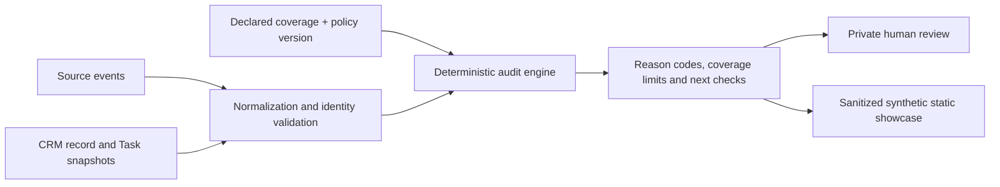

# HandoffTrace — Public architecture and design decisions

**Updated:** 2026-11-03 · **Product:** HandoffTrace (formerly developed as Revenue Leak Monitor) · **Deployment boundary:** the published v0.5 website is a synthetic static preview, **not** the private Django audit application.

This is a deliberately public-level explanation. It does not disclose commercial source code, private security internals, credentials, event payloads, unreleased policies, or customer information.

## Two different runtime surfaces

| Surface | What runs | Audience and current status |
|---|---|---|
| **Private audit implementation** | Framework-independent Python reconciliation engine, private Django operator interface, policies, exports and experimental read-only adapters | Development and controlled local/sandbox testing; **not public production SaaS** |
| **[Public interactive preview](https://handofftrace.htlabs.workers.dev/)** | One self-contained HTML artifact with CSS, JavaScript and sanitized, precomputed fictional findings | Publicly viewable; no accounts, uploads, live analysis, or CRM connections |

A Python build step generates the public output using pinned fictional source and CRM fixtures, runs the engine, verifies selected result expectations, and exports only a bounded synthetic result. Public visitors navigate that result; they do **not** execute the engine or submit data for processing.

## Decision 1 — Independent assurance, not another workflow

HandoffTrace evaluates **the outcome supported by records and evidence**, not the execution status of an upstream tool. A 200 response, completed automation, or existing Contact is insufficient evidence that an individual submission was handed off correctly. The product neither replaces a CRM nor currently executes automatic repairs.

## Decision 2 — Event identity differs from Contact identity

Multiple form submissions can refer to one Contact. The system treats a **source event** as the unit of review and does not silently turn one Contact into proof of delivery for every event. Deterministic matching depends on explicit identifiers and declared mapping rules. Inaccessible, duplicate, or ambiguous mappings must not be guessed into success or failure.

The current selected-data engine demonstrates explicit event-key reconciliation; this must not be misrepresented as universal production-grade identity resolution for all CRMs or form platforms.

## Decision 3 — Time, completeness and provenance are part of a conclusion

The audit distinguishes event time, snapshot time, Task creation evidence, SLA deadline, source coverage, and rule version. A Task absent from an incomplete or early snapshot is not a proven failure. Missing evidence and evidence of missing action are **different claims**.

Operator declarations of completeness are not automatically independently verified. Without independent source coverage, findings remain limited to the supplied evidence boundary.

## Decision 4 — Deterministic, inspectable findings before AI

The Python engine produces reviewable classifications, multiple reason codes, next checks, and reproducible policy-dependent decisions. AI-generated summaries and autonomous actions are **not required for current outputs** and are not advertised as released customer features.

## Decision 5 — Configurable policies without retroactively rewriting runs

Versioned policy profiles can describe eligibility/exclusion, ownership expectations, timing and SLA criteria. Existing audit records retain the policy context used at the time of evaluation. A customer-specific mapping or rule change requires source and identity validation; there is no public self-service rule editor in the preview.

## Decision 6 — Separate experimental connectors from validated customer onboarding

- **HubSpot:** Authorized Sandbox experiments, selected Form export comparisons, Contact and Task reads, OAuth lifecycle/guard development. These demonstrate technical progress, **not** complete event-to-follow-up lineage, historical completeness, or production customer readiness.
- **Salesforce:** Bounded read-only experimental inventory, without live-org acceptance or production OAuth.
- **CRM writes:** Absent from the public preview; automated remediation remains a proposed future capability, not a feature users can execute.

The first potential managed pilot should be **read-only and explicitly scoped**. Real customer data must not enter the local prototype or an unreviewed service until the required permissions, security, storage, recovery, tenant/access, and evidence-coverage controls have been accepted.

## Decision 7 — Public code visibility is not part of the product offer

The private commercial repository contains the underlying implementation and tests; this public case study shows only architecture-level decisions and bounded acceptance observations. A public source disclosure is not required to evaluate the value proposition, but visitors also cannot inspect or reproduce all private tests from this repository alone.

## High-level evidence flow

**No pipeline shown above is proof that a customer deployment, actual salesperson contact, lead loss, or revenue recovery occurred.**

See [the project overview](README.md), [test evidence](EVIDENCE.md), and [development log](BUILD_LOG.md).
