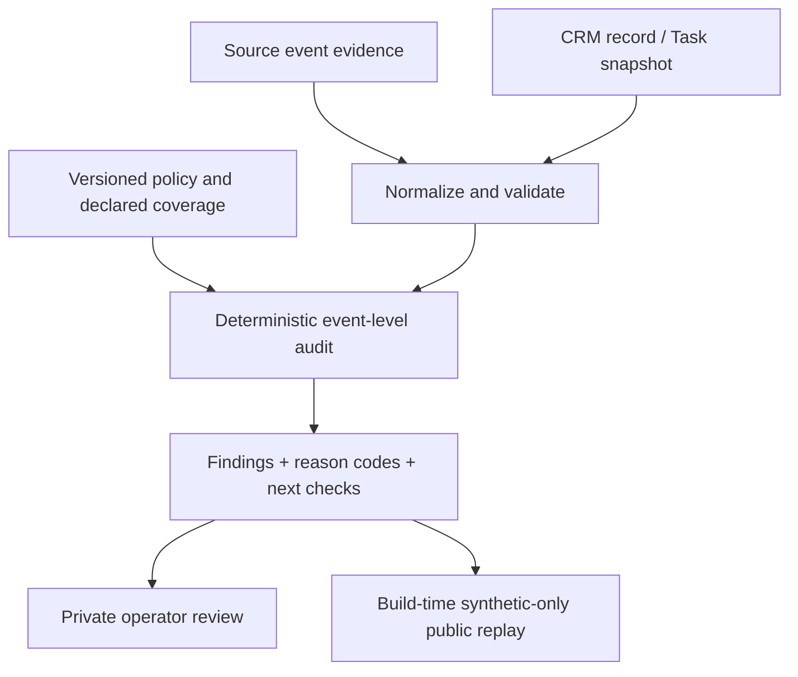

# HandoffTrace — Evidence-first Lead Handoff Assurance

**Public status (2026-11-03):** Interactive **v0.5 product preview is published** at **https://handofftrace.htlabs.workers.dev/**. This is a **static, synthetic-data demonstration** of a real, independently implemented audit engine's output—not a customer-connected SaaS deployment or a live monitoring service.

**Product identity:** HandoffTrace is the public name for the proprietary product developed under the earlier working name **Revenue Leak Monitor**. The original `projects/revenue-leak-monitor/` documentation path remains in place to preserve existing links.

**Engineering direction, product requirements, and acceptance review:** Mahdi Eqbal. Implementation and testing have included AI-assisted development. The product is independently developed and actively evolving. No paid customer deployment, recovered revenue, or completed production rollout is claimed.

> A successful workflow execution is not, by itself, proof of an event-specific CRM handoff.

## The operational problem

A form may submit, an integration may return success, and a Contact may exist in HubSpot or Salesforce—while the question of what happened to **that particular lead event** remains unanswered.

HandoffTrace is a **standalone assurance layer**, not another CRM workflow. Its purpose is to reconcile separately observed source events with CRM records and available handoff evidence, distinguish verified observations from uncertainty, and give an operator reviewable reasons and next checks.

## Try the public preview

**[Open the interactive HandoffTrace preview](https://handofftrace.htlabs.workers.dev/)**

Visitors can explore a fixed audit of **five fictional source events** and **three fictional CRM rows**, filter findings, inspect example cases, and read reason codes and suggested read-only checks. The published page also explains current capabilities, an individually assessed assisted-pilot option, and proposed future paid features.

**Important implementation boundary:** The public website serves an exported, self-contained HTML file with a sanitized replay of **precomputed Python-engine findings**. Selecting or filtering cases runs presentation JavaScript; the visitor's browser does **not** execute the reconciliation engine or contact a CRM. There is no login, customer-data upload, live CRM connection, customer-specific report generation, continuous monitoring, or self-service configuration on the public site. Hosting infrastructure may independently log requests.

## Capabilities implemented in private development code

These are capabilities of the underlying prototype and locally evaluated engine, **not promises of publicly available SaaS features**:

- **Deterministic source-to-CRM reconciliation:** Compare separately supplied source-event and CRM snapshots using an explicit shared event identifier and declared scope, timestamps, and expected cardinality.
- **Event identity and duplicate controls:** Deduplicate repeated input rows, detect conflicting keys, and preserve the distinction between distinct submissions and CRM Contact identity.
- **Owner, Task, and SLA evidence checks:** Evaluate permitted ownership, presence and chronology of recorded Task evidence, grace windows, and time-based rules. A Task's existence is not proof of real human outreach.
- **Explainable results:** Return status/reason codes, evidence limitations, review suggestions, and CSV/JSON-safe output.
- **Configurable policy and rule profiles:** Support different eligibility/exclusion, ownership, timing, and SLA expectations; the local private application has versioned profiles and saved runs. Customer-specific setup is a **scoped engineering/pilot service**, not a public configuration screen.
- **Private operator experience:** An authenticated, locally exercised Django app includes audit history, workspace-scoped views, evidence review, and dry-run remediation guidance. This is **not** exposed as a production public web app.

### Demonstration examples

| Fictional event | Engine observation | Correct interpretation |
|---|---|---|
| E101 | Handoff evidence found | Supplied CRM, owner, and Task timing satisfy the selected synthetic rule; a conversation with the lead is **not** proven |
| E102 | No matching CRM record in the declared snapshot | Review actual source/CRM completeness and identity before asserting the lead was lost |
| E103 | Owner-related evidence exception | Inspect owner routing and any missing Task/SLA evidence under the rule |
| E104 | Intentionally excluded | Ineligible under the synthetic policy; not a lost lead |
| E105 | Repeated source row, evaluated once | Duplicate input should not create two independent handoff decisions |

These records, IDs, and findings are fictional. **No amount of recovered revenue or real missed follow-up has been established by this showcase.**

## Engineering approach

The core Python audit engine is separate from the Django operator application and from exploratory connector adapters. Public hosting contains **only the static replay**, not the Django service, database, private engine code, or provider credentials. Read the [public architecture notes](ARCHITECTURE.md) for trade-offs.

## Connection research and validation: what is and is not proven

**HubSpot:** Local synthetic connector tests and bounded authorized Sandbox reads have been performed. In a separately controlled test account, an operator-exported form CSV preserved three independent synthetic submissions (including two for the same Contact). Selected Contact/Task reads and OAuth-related controls have been exercised. **Independent source-history completeness and the exact event-to-Task-to-owner handoff were not end-to-end validated.** OAuth/security components under test do not amount to production-ready customer onboarding.

**Salesforce:** An experimental GET-only Lead/Contact/Task inventory adapter exists in private code. It has **not** been accepted against an authorized live Salesforce customer/org integration.

**Customer CRM connectivity, continuous alerting, automatic CRM remediation, AI-assisted investigation, public accounts, billing, and self-service configuration are not released.** CRM modification is outside the current public preview and initial read-only assessment scope.

## Assisted-pilot option

Organizations can request a **narrow, individually assessed read-only lead-handoff review**, potentially using authorized, carefully scoped exports and organization-specific rules. A conversation about a pilot is **not** acceptance of customer data. Any actual delivery requires appropriate authorization, source/event coverage validation, secure handling, workspace access review, and relevant operational gates.

To discuss feasibility without sending customer records: **[Request a scoped pilot](mailto:m.mahdi.eqbal@gmail.com?subject=HandoffTrace%20scoped%20pilot)**.

## Technical evidence and change history

- [Evidence and limitations](EVIDENCE.md) — what was observed, tested, and remains unverified.
- [Architecture decisions](ARCHITECTURE.md) — event identity, deterministic evaluation, uncertainty, and security boundaries.
- [Development log](BUILD_LOG.md) — dated milestones, including the November 2026 public launch checkpoint.

The source repository, internal CI logs, implementation code, credentials, and sensitive provider acceptance artifacts are **private**. Public documentation can explain engineering decisions and evidence boundaries but does not independently expose the private test suite or certify a production deployment.

## Source code and intellectual-property boundary

**This is a public engineering case study, not an open-source release of HandoffTrace.** The commercial source is proprietary and private; the portfolio repository's license does not confer rights to that source. No customer PII, secrets, private exports, credentials, or unrestricted internal security procedures are included here.

---

**Developed by [Mahdi Eqbal](https://github.com/mahdi-eqbal) · [HandoffTrace preview](https://handofftrace.htlabs.workers.dev/) · [LinkedIn](https://www.linkedin.com/in/mahdi-eqbal)**
