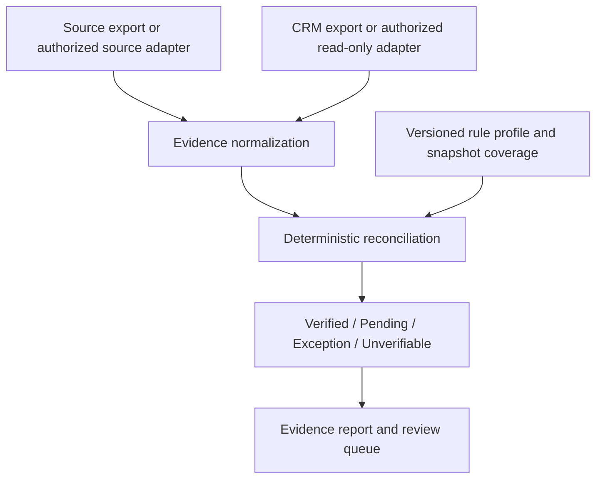

# Revenue Leak Monitor — Evidence-first lead handoff assurance

**Status:** v0.5 development code merged in private GitHub; currently installed Windows prototype remains v0.4 · **Source:** proprietary/private · **Case study updated:** 2026-10-29

**Engineering direction, requirements and local acceptance testing:** Mahdi Eqbal. Implementation and testing have included AI-assisted development. This is an independent product-development project, **not** a claim of a paid customer deployment or recovered revenue.

> A successful webhook or CRM write does not prove that a lead reached the right owner and received the required follow-up.

## The problem

Marketing operations, lead-generation agencies, and B2B sales teams frequently rely on several connected systems: forms, advertising platforms, automation tools and CRMs. Each can report a technically successful step while the end-to-end business handoff remains incomplete.

Revenue Leak Monitor is being built as a **read-only assurance layer** that reconciles separately observed source events with CRM handoff evidence. Its job is to distinguish confirmed behavior, missing records, uncertain evidence and pending work — **not** to calculate revenue loss from simple record-count differences.

## What has been built and locally validated

- A deterministic Python engine for comparing source-event exports with CRM exports using an **explicit shared event ID**; no speculative identity matching.
- Separate states for matched records, duplicate submissions, intentional exclusions, missing CRM records, ambiguous matches, stale snapshots, ownership gaps and follow-up timing.
- Evidence-first reporting with reason codes, human-readable explanations, CSV/JSON exports, policy identifiers and file fingerprints.
- A local Django web application for authenticated uploads, audit history, owner-scoped access and named, versioned rule profiles.
- Temporal SLA evaluation: task evidence is distinguished from actual human outreach; an event can be *within* its permitted window without being labeled a breach.
- A demonstration page using synthetic fixtures, currently available **only in the local development app**, not as a hosted public service. A **HubSpot contact-read adapter** has been implemented and tested against mocked API responses; it is **not** a validated live HubSpot integration.

### High-level system boundary

The software **does not write to the CRM** in this milestone.

## Example from the synthetic demonstration

| Event | Observed outcome | What the result means |
|---|---|---|
| E101 | Handoff evidence verified | Matching CRM record, permitted owner and task-creation evidence found |
| E102 | No matching CRM record | Under explicitly attested complete and timely source/CRM snapshots |
| E103 | Owner missing or invalid | Other reason codes can also identify missing task and breached SLA |
| E104 | Intentionally excluded | Ineligible by the supplied test rule; not treated as a lost lead |
| E105 | Duplicate source event | Duplicate input counted once; matching handoff evidence still examined |

All identifiers above are **fictional**. Even the term *verified handoff* proves only the specified system evidence: **not** a completed sales conversation, lead qualification, new revenue or recovered revenue.

## Verification and development record

- [Test evidence and limitations](EVIDENCE.md) — observed synthetic outcomes, boundary tests, CI verification scope and known constraints.
- [Public build log](BUILD_LOG.md) — honestly documents the local milestones and the later GitHub migration.
- [Architecture decisions](ARCHITECTURE.md) — important engineering trade-offs **without releasing source code or proprietary matching implementation**.

The local prototype was exercised on a Windows machine using fictional CSVs. GitHub-hosted CI was subsequently run on the **private source repository** across Python 3.11, 3.12 and 3.13. CI results and source-level review are available to **authorized reviewers only**; anonymous visitors cannot inspect private GitHub Actions or commit history.

## Current limitations

This is a **development prototype**, not a production multi-tenant SaaS or a certified secure service. Completeness of CSV snapshots is currently operator-attested, the local database is SQLite, and authorization is scoped to individual users rather than production-ready organizations/workspaces. Live HubSpot OAuth, full Task evidence collection, tenant isolation, encryption/retention controls and operational deployment require further work.

## Source and IP boundary

**This public case study documents the engineering work; it is not the product source.** The core source, test suite, private Pull Requests, internal security notes and unpublished connectors remain in a private commercial repository under an **All rights reserved** notice. No customer exports, CRM tokens, credentials or local databases are included here. The portfolio repository's MIT license applies to its publicly released contents; it does **not** grant rights to private Revenue Leak Monitor source.

For a technical walkthrough, permitted demo or agency collaboration: [contact by email](mailto:m.mahdi.eqbal@gmail.com?subject=Revenue%20Leak%20Monitor%20technical%20walkthrough).

---
**Engineering record maintained by [Mahdi Eqbal](https://github.com/mahdi-eqbal).**
